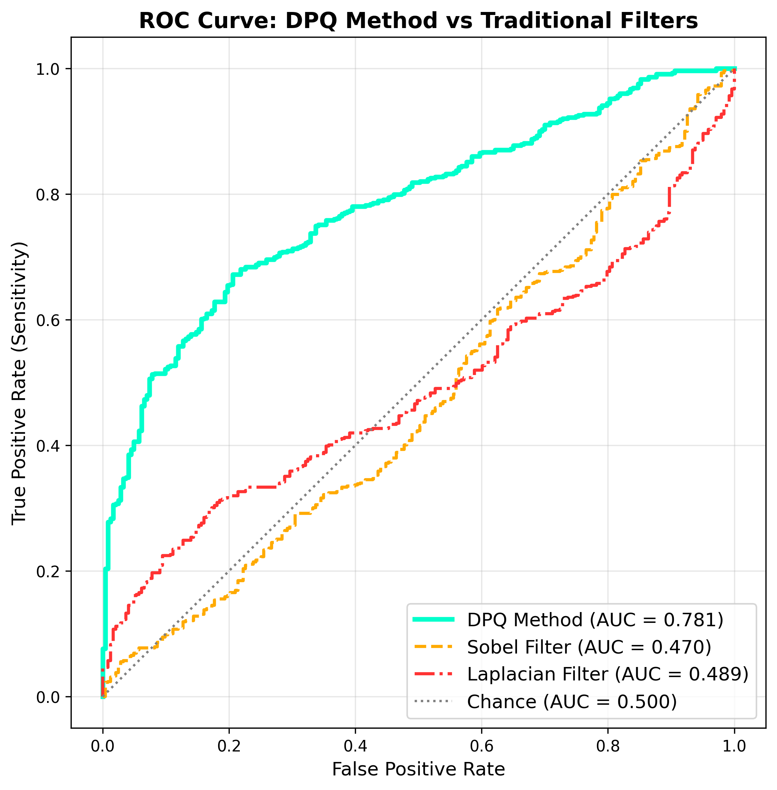

# Dupla Projeção Quadrática (DPQ) Method

**Author:** Emanuel Eduardo (ORCID: 0009-0005-0777-963X)  
**Contact:** chandeeduardo15@gmail.com

This repository contains the source code and validation data for the **Dupla Projeção Quadrática (DPQ) Method**, a deterministic model based on the Topological Identity \(K = A - B\) for detecting cellular anomalies in light microscopy.

## About the Method

The method calculates a Cellular Isometry Index using the following equations:
- \(A = \frac{(C+K)^2}{4C}\)
- \(B = \frac{(C-K)^2}{4C}\)
- Invariant: \(K = A - B\)
- Isometry: \(I_c = \frac{\min(A, B)}{\max(A, B) + \epsilon}\)

The optimal parameters found for the light microscopy domain were \(C=3\) and \(K=5.0\).

## Results

The method was validated on the public **BloodMNIST** dataset.
- **DPQ Method ROC-AUC:** **0.7815**
- **Traditional Methods (Sobel & Laplacian):** AUC of 0.470 and 0.489 (below chance level).



## How to Reproduce

1. Install dependencies:
   ```bash
   pip install -r requirements.txt
   python dpq_engine.py
